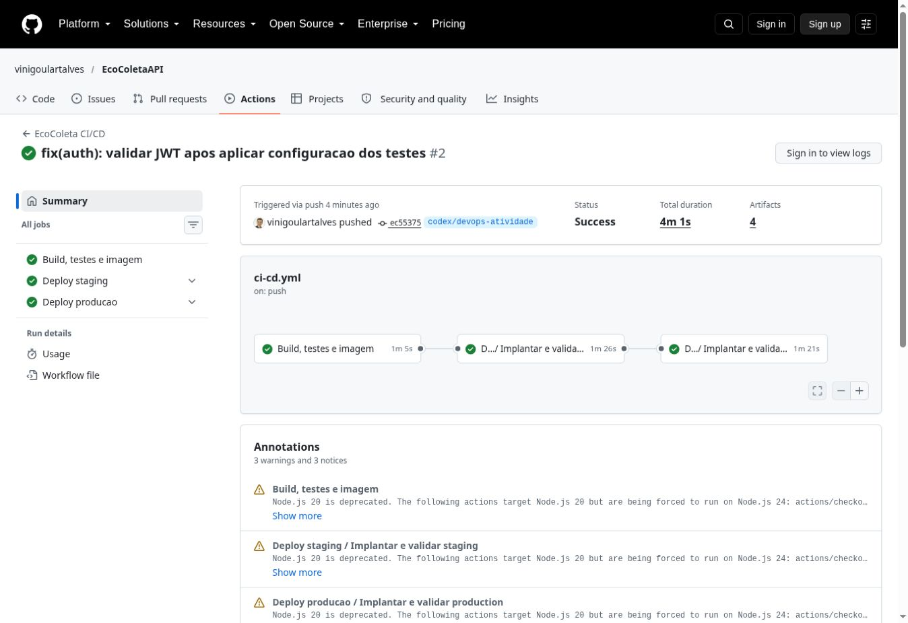
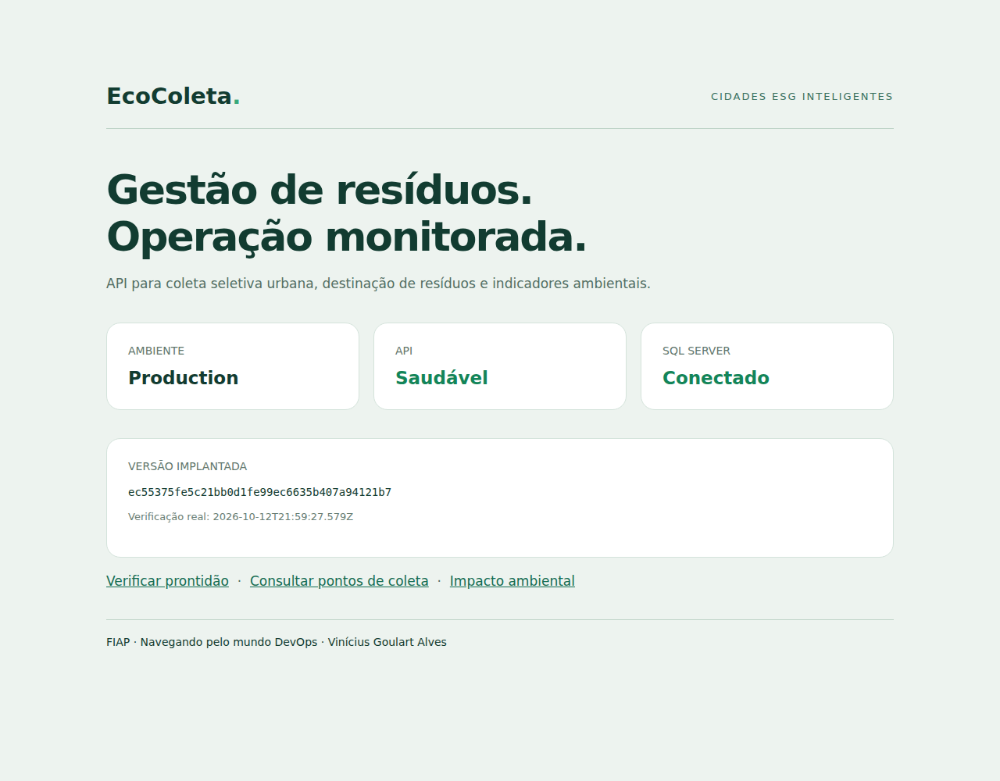

# Evidências reais da entrega DevOps

Execução validada em **12/10/2026**, das 18h55 às 18h59 (horário de Brasília).

- [Pipeline completo #2 - sucesso](https://github.com/vinigoulartalves/EcoColetaAPI/actions/runs/38313648214)
- Commit executado: `ec55375fe5c21bb0d1fe99ec6635b407a94121b7`.
- Branch de trabalho: `codex/devops-atividade`.
- Build Release: **0 avisos de compilação e 0 erros**.
- xUnit: **11 aprovados, 0 falhas**.
- Cobertura de linhas: **37,75%** (612/1621); ramificações: **38,97%**.
- Staging e produção: **9 verificações HTTP no smoke + 2 na confirmação de persistência, por ambiente**, com validações adicionais do conteúdo.
- Os dois jobs registraram o mesmo ID de imagem: `sha256:3257183f0e1edfeafeedae72abbea8b6bb19d2663d418a2b8258cb1ef78d1c3c`.

## Pipeline

| Job | Estado | Link de verificação |
|---|---|---|
| Build, testes e imagem | Sucesso | [Job](https://github.com/vinigoulartalves/EcoColetaAPI/actions/runs/38313648214/job/115025027757) |
| Deploy staging | Sucesso | [Job](https://github.com/vinigoulartalves/EcoColetaAPI/actions/runs/38313648214/job/115025384839) |
| Deploy produção | Sucesso | [Job](https://github.com/vinigoulartalves/EcoColetaAPI/actions/runs/38313648214/job/115025858317) |

O GitHub exibe avisos de manutenção sobre o runtime Node das actions v4 e a futura mudança de `ubuntu-latest`. Esses avisos não são erros do build .NET; as actions foram executadas pelo runner com Node 24 e todos os jobs passaram. A versão do runner e os detalhes estão nos logs.

## Staging

- [Resultado HTTP e fluxo autenticado](staging/smoke.json).
- [Persistência após reinício](staging/persistence.json).
- [Saúde da aplicação](staging/health.json).
- [Contêineres saudáveis](staging/compose-ps.txt).
- [ID da imagem](staging/image-id.txt).

## Produção acadêmica

- [Resultado HTTP e fluxo autenticado](production/smoke.json).
- [Persistência após reinício](production/persistence.json).
- [Saúde da aplicação](production/health.json).
- [Contêineres saudáveis](production/compose-ps.txt).
- [ID da imagem](production/image-id.txt).

A captura é feita enquanto a stack está ativa. Os ambientes dos runners são temporários e encerrados após a coleta; os prints não representam serviços públicos ainda online. Nenhum resultado, resposta HTTP ou captura foi simulado.

## Build e testes

- [Trechos do log de build, testes e criação da imagem](build-test-image.log.txt).
- [Resumo dos resultados TRX](testes/results.json).
- [Resumo da cobertura Cobertura](testes/coverage-summary.json).
- [Metadados da execução, jobs e artefatos](run.json).

Os resumos versionados preservam os resultados e omitem metadados internos do runner. Os arquivos TRX, Cobertura XML e logs integrais permanecem nos artefatos da execução do GitHub Actions. A primeira execução falhou na configuração JWT dos testes; a segunda, documentada aqui, validou a correção. A documentação e as evidências foram adicionadas depois do commit executado, sem alterar a implementação validada.

## Checklist de entrega

| Item | OK |
|---|---|
| Projeto compactado em ZIP com estrutura organizada | [x] |
| Dockerfile funcional | [x] Construído e executado |
| docker-compose.yml ou arquivos Kubernetes | [x] Compose com API, SQL, rede, volume e variáveis |
| Pipeline com build, teste e deploy | [x] Execução #2 aprovada |
| README com instruções e prints | [x] README + estas evidências |
| Documentação técnica com evidências em PDF | [x] PDF entregue junto ao ZIP |
| Deploy em staging e produção | [x] Realizado em dois ambientes acadêmicos temporários |
